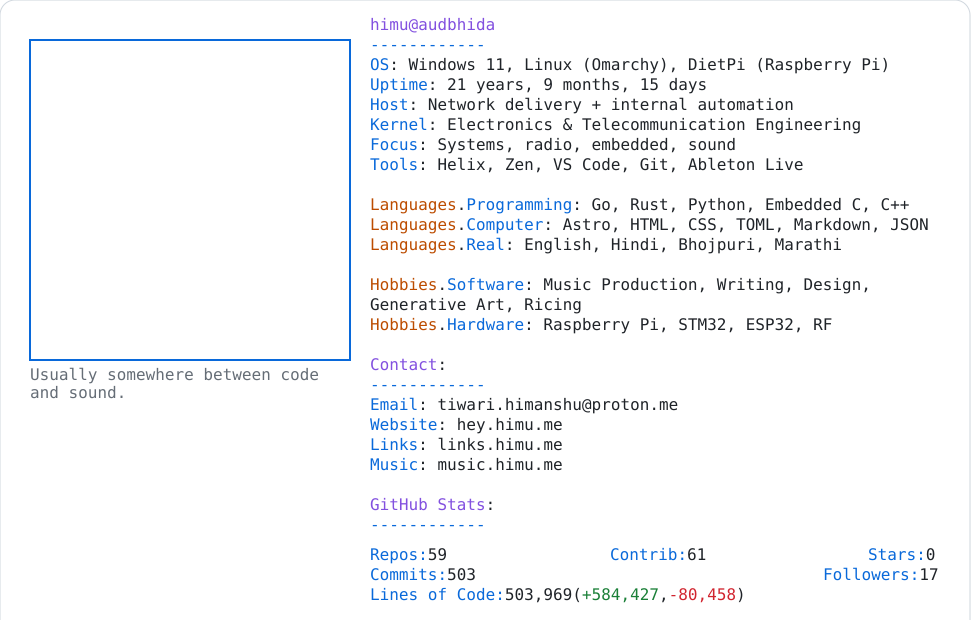

<a href="https://github.com/HimuCodes">
  <picture>
    <source media="(prefers-color-scheme: dark)" srcset="https://raw.githubusercontent.com/HimuCodes/HimuCodes/main/dark.svg?b=1793875687">
    
  </picture>
</a>
